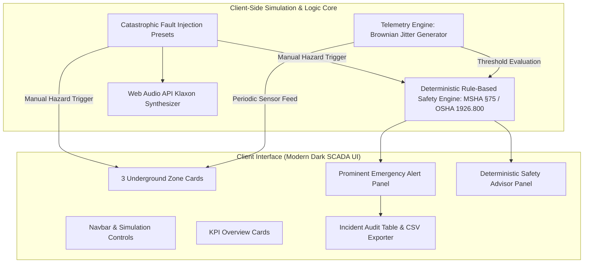

# MindShield AI | Mining Safety Telemetry Prototype

> **Engineering Notice:** MindShield AI is a modern dark industrial web prototype engineered for underground mining safety monitoring. All telemetry data streams (CH₄, CO, O₂, temperature, vibration, ventilation airflow, and particulate dust) are synthetically generated for UI/UX validation and supervisory testing. **This system is not connected to physical underground mine hardware or life-safety PLC interlocks.**

---

## 📌 Table of Contents
- [Executive Overview](#executive-overview)
- [System Architecture](#system-architecture)
- [Core Features](#core-features)
- [Deterministic Safety Advisor Matrix](#deterministic-safety-advisor-matrix)
- [Subterranean Zones Monitored](#subterranean-zones-monitored)
- [Hazard Simulation Scenarios](#hazard-simulation-scenarios)
- [Step-by-Step Getting Started](#step-by-step-getting-started)
- [Production Build & Verification](#production-build--verification)
- [Project Directory Structure](#project-directory-structure)
- [Limitations & Operational Scope](#limitations--operational-scope)

---

## 🧭 Executive Overview
Subterranean mining presents extreme environmental risks: explosive methane gas pockets, toxic carbon monoxide leaks from smoldering conveyor belts or heavy diesel equipment, seismic rockburst tremors from high-stress strata, and dangerous ventilation fan stoppages.

**MindShield AI** delivers a high-contrast dark industrial SCADA dashboard designed according to ergonomic supervisory standards. It continuously tracks atmospheric and geotechnical telemetry across multiple underground stopes, executes real-time deterministic safety compliance rules, visualizes alarm conditions, and provides audit logging with CSV export capabilities.

---

## ⚙️ System Architecture

MindShield AI is built as a single-page application utilizing **React 18**, **Tailwind CSS**, and **Vite**, along with the browser-native **Web Audio API** and **Blob API**.



### Key Technical Attributes
1. **Zero External Paid APIs or Cloud Credentials:** Operates 100% client-side with zero external network dependencies.
2. **Deterministic Safety Engine:** Explicitly avoids black-box, non-deterministic AI models for life-critical safety recommendations. All directives originate from deterministic Boolean logic rules based on MSHA (30 CFR Part 75) and OSHA (29 CFR 1926.800) standards.
3. **High-Performance Audio Synthesizer:** Produces industrial warning alarms directly via the Web Audio API oscillator nodes, avoiding bulky audio file downloads.
4. **RFC-4180 CSV Pipeline:** Encodes UTF-8 incident audit logs into CSV format directly on the client.

---

## 🚀 Core Features

### 1. Multi-Sensor Atmospheric & Geotechnical Telemetry
Monitors seven continuous sensor readings per zone:
- **Methane ($CH_4$ in % LEL):** Explosive limits calibrated to MSHA §75.323 standards (Safe: $<1.00\%$, Warning: $1.00\%-1.49\%$, Critical: $\ge 1.50\%$).
- **Carbon Monoxide ($CO$ in ppm):** Toxic combustion detection (Safe: $<25$ ppm, Warning: $25-49$ ppm, Critical: $\ge 50$ ppm).
- **Oxygen ($O_2$ in %):** Asphyxiation and breathable atmosphere verification (Safe: $19.5\% - 23.0\%$, Critical: $<19.5\%$).
- **Rock/Air Temperature ($°C$):** Smoldering fire and equipment overheating detection (Safe: $<32.0°C$, Warning: $32.0-39.9°C$, Critical: $\ge 40.0°C$).
- **Seismic Vibration (PPV in mm/s):** Strata shockwaves and rockburst risk (Safe: $<4.0$ mm/s, Warning: $4.0-7.9$ mm/s, Critical: $\ge 8.0$ mm/s).
- **Ventilation Velocity ($m/s$):** Air split ventilation quantity (Safe: $>1.50$ m/s, Warning: $0.60-1.49$ m/s, Critical: $<0.60$ m/s).
- **Respirable Particulate / Dust ($AQI$):** Coal/silica dust and smoke density (Safe: $<80$, Warning: $80-149$, Critical: $\ge 150$).

### 2. Three Dedicated Subterranean Sectors
- **Zone Alpha — Shaft 04 (-680m depth):** Deep extraction core and active stope; 14 workers on-shift; escape via Surface Cage 1; fallback to Refuge Station A-04 (96-hour life support).
- **Zone Beta — Sub-Level 2 (-420m depth):** Primary ore crushing and transfer conveyor; 8 workers on-shift; escape via West Drift Ramp; fallback to Refuge Station B-02 (72-hour life support).
- **Zone Gamma — Drift 09 (-250m depth):** Heavy diesel haulage and rail transport gallery; 19 workers on-shift; escape via North Portal Adit; fallback to Refuge Station C-01 (48-hour life support).

### 3. Catastrophic Hazard Simulation Engine
- Interactive hazard modal and per-zone test triggers.
- Injects 5 realistic mining emergency scenarios:
  1. *Methane ($CH_4$) Flare & Outburst* (spikes to $2.85\%$ LEL)
  2. *Carbon Monoxide & $O_2$ Depletion* (spikes to $88$ ppm CO, drops to $18.4\% O_2$)
  3. *Severe Seismic Tremor & Rockburst* (spikes to $14.6$ mm/s PPV)
  4. *Conveyor Thermal Runaway / Belt Fire* (spikes to $48.2°C$ and $290$ AQI)
  5. *Auxiliary Ventilation Fan Failure* (drops airflow to $0.15$ m/s)
- Immediately updates telemetry, trips the alarm klaxon, and recomputes safety directives.

### 4. Deterministic Rule-Based Safety Advisor Panel
- Clearly labeled as a **Deterministic Rule-Based Safety Engine** without claiming generative AI capabilities.
- Dynamically assigns protocols:
  - **Level 1:** Normal Routine Monitoring
  - **Level 2:** Preventative Hazard Mitigation & Caution
  - **Level 3:** Critical Hazard Emergency Interlock Activated
- Provides interactive safety officer sign-off checklists, specific evacuation routes, and designated refuge chamber directions.

### 5. Incident & Telemetry Audit Log Table
- Tracks ID, timestamp, zone, severity, hazard anomaly, sensor readings, and recommendations.
- Interactive filtering by severity (All, Critical, Warning, Resolved) and keyword search.
- **Confirmed Clear Action:** Requires explicit modal confirmation to prevent accidental audit loss.
- **Working CSV Export:** Generates and downloads RFC-4180 compliant CSV files with full metadata.

### 6. Simulation & Telemetry Controls
- **Pause / Resume:** Freezes or resumes the live stochastic telemetry ticker with visual state indicators.
- **Simulation Speed Selector:** Allows testing at 1.0s (Fast), 2.5s (Default), or 5.0s (Relaxed) intervals.
- **Reset Demo:** Restores all three sectors to calibrated safe baselines, clearing injected faults and active alerts.
- **Audio Alarm Toggle:** Enables or mutes the Web Audio API alarm synthesizer.

---

## 🛠️ Step-by-Step Getting Started

### Prerequisites
- [Node.js](https://nodejs.org/) version 18.0.0 or higher.
- [npm](https://www.npmjs.com/) version 9.0.0 or higher.

### Installation
1. Clone or navigate to the project directory:
   ```bash
   cd mindshield_ai
   ```
2. Install dependencies:
   ```bash
   npm install
   ```

### Running the Development Server
Launch Vite's hot-reloading development server:
```bash
npm run dev
```
Open your browser at `http://localhost:3000` (or the port indicated in your terminal).

### Creating a Production Build
Compile and bundle optimized static assets:
```bash
npm run build
```

### Previewing the Production Build
Preview the generated production build locally:
```bash
npm run preview
```

---

## 🧪 Verification Matrix

| Component / Feature | Verification Method | Status |
| :--- | :--- | :---: |
| **Simulated Telemetry Feed** | Verified periodic jitter across all 7 sensor dimensions | ✅ Verified |
| **Three Main Mining Zones** | Verified display of Zone Alpha (-680m), Zone Beta (-420m), Zone Gamma (-250m) | ✅ Verified |
| **Hazard Simulator Modal** | Verified injection of CH₄, CO, Seismic, Thermal, and Vent failures | ✅ Verified |
| **Prominent Alert Panel** | Verified real-time alert banner, severity badges, and one-click resolution | ✅ Verified |
| **Deterministic Safety Advisor** | Verified rule execution without external AI APIs (MSHA/OSHA matrix) | ✅ Verified |
| **Incident History Table** | Verified chronological logging, search, and filtering | ✅ Verified |
| **CSV Export Functionality** | Verified RFC-4180 Blob generation and browser download trigger | ✅ Verified |
| **History Clear Confirmation** | Verified modal prompt preventing accidental data purge | ✅ Verified |
| **Simulation Pause / Resume** | Verified interval freeze and visual indicator toggle | ✅ Verified |
| **Reset Demo Control** | Verified restoration of all sensors and zones to safe baseline | ✅ Verified |
| **Hardware Disclaimer** | Verified prominent notices distinguishing synthetic demo from physical hardware | ✅ Verified |
| **Production Build** | Verified Vite production bundling (`npm run build`) | ✅ Verified |

---

## 📁 Project Directory Structure

```text
mindshield_ai/
├── index.html                 # Application HTML root with industrial styling & fonts
├── package.json               # Package definitions and build scripts
├── postcss.config.js          # PostCSS configuration for Tailwind CSS
├── tailwind.config.js         # Custom industrial dark theme palette and keyframes
├── vite.config.js             # Vite bundler configuration
├── src/
│   ├── App.jsx                # Root application coordinator and state store
│   ├── main.jsx               # React DOM entry point
│   ├── index.css              # Tailwind base, utilities, and SCADA glow styles
│   ├── data/
│   │   ├── initialData.js     # Calibrated baselines, zone definitions & hazard presets
│   │   └── rulesEngine.js     # Deterministic MSHA/OSHA rule-based advisory engine
│   ├── components/
│   │   ├── Navbar.jsx         # Industrial header with simulation & audio controls
│   │   ├── DisclaimerBanner.jsx # Hardware simulation and architecture disclaimer
│   │   ├── OverviewCards.jsx  # KPI metrics: Mine Integrity, CH4, PPV, Airflow, Miners
│   │   ├── ZoneCards.jsx      # Zone cards with live gauges, status LED & egress drawer
│   │   ├── AlertPanel.jsx     # Active emergency alarm dispatch panel
│   │   ├── SafetyAdvisorPanel.jsx # Deterministic checklist & protocol recommendations
│   │   ├── IncidentHistoryTable.jsx # Audit table with filtering, search & export
│   │   ├── ClearHistoryConfirmModal.jsx # Safety modal for history purge
│   │   ├── HazardSimulatorModal.jsx # Interactive fault injection modal
│   │   └── Footer.jsx         # Regulatory references and legal notices
│   └── utils/
│       ├── audioAlert.js      # Web Audio API synthesizer for industrial klaxons
│       └── csvExporter.js     # RFC-4180 client-side CSV generator & downloader
└── README.md                  # Comprehensive technical documentation
```

---

## ⚠️ Limitations & Operational Scope
1. **Simulation Fidelity:** Telemetry is algorithmically computed using calibrated Brownian micro-fluctuations for demonstration. It does not interface with actual physical CANopen, Modbus, or HART subterranean fieldbuses.
2. **Rule Matrix:** The safety advisor uses deterministic rules patterned on standard underground mining safety regulations (MSHA 30 CFR / OSHA 1926.800). It must not be deployed as an autonomous life-safety interlock system in real operating mines without formal regulatory certification.
3. **No External AI Model:** This application deliberately does not query OpenAI, Anthropic, Gemini, or any external machine-learning endpoint, ensuring air-gapped predictability, zero latency, and zero operational cost.
